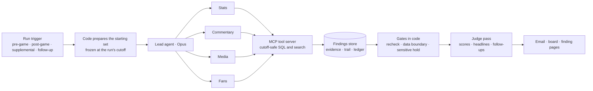

# NBL Storyline Desk

**An agent desk that turns each NBL game into checked, cross-source storylines for leadership and producers, inside 30 minutes of the final whistle.** It's built on the Claude Agent SDK and run on real NBL27 data: the Round 1 opener, Melbourne United 95–97 Adelaide 36ers.

> **See it live:** the [leadership briefing email](https://fridai-dot-dev.github.io/nbl-storyline-desk/outbox/post-game-email.html) · a [record stat with its proof](https://fridai-dot-dev.github.io/nbl-storyline-desk/findings/25.html) · a [producer follow-up, answered](https://fridai-dot-dev.github.io/nbl-storyline-desk/findings/39.html) · [the producer board](https://fridai-dot-dev.github.io/nbl-storyline-desk/) · [how it was built](docs/build-log.md)
> The same pages are in [`site/`](site/).

## What it found on Round 1

Each of these came from agents working across the stats, the broadcast, the press conferences and the live fan chat. Code then checked them before release.

- **Cole Anthony scored 30 in 21:50, the fewest minutes for a 30-point game in the box-score data since 2015-16,** among box rows with minutes recorded: 370 such games up to that night. The stats specialist found it after the game and wrote it as its own checked record. It was held because it touches his reported minutes limit, and the demo approver has signed it off for producers only.
- **Melbourne's bench outscored Adelaide's by 30, and Melbourne still lost.** It was a producer's follow-up question. Since 2015-16, the weaker bench has won 18 of 74 games with a gap that size. Adelaide's starter-heavy load wasn't new: it was close to last season's share.
- **A fan's "10-point referee gift" claim, tested against the play-by-play.** Melbourne scored 4 fourth-quarter free-throw points and Adelaide scored 5. The desk didn't amplify the claim, and it showed the same message had been posted twice in 81 seconds.
- **Adelaide won from three, not on balance.** They made 13 threes to Melbourne's 7, an 18-point edge, while Melbourne won the two-point battle 58–38.
- **Pre-game storylines set as tests, then resolved after the whistle.** Cotton's "Melbourne hold him to 21" benchmark was contradicted when he scored 29. Goulding's "easier looks" storyline was contradicted when he went 1 of 6.

## How it works



- **Code sets the rails and agents explore.** Code decides when a run happens, what it starts with, and what may leave the system. Agents decide where to look and how far to go, and branch when a finding is worth following.
- **Every run is frozen at its cutoff.** Tools can't see anything after it, which the tests prove, so a replayed game behaves as it would have live.
- **One lead with four specialists.** Opus leads and four Sonnet specialists work in parallel, with spend, depth and time capped. Our code enforces the 25-minute post-game deadline.
- **Findings carry their evidence and their trail.** Every finding stores its sources (URL plus row or timestamp) and its parent, so you can follow a lead from a commentator's call to the play-by-play and into the record books.

## Why the output can be trusted

- **Numbers are rechecked by code.** Every checked number stores the SQL that produced it, and code re-runs it before release. Wrong numbers are dropped. Quoted numbers stay inside the quote with their source.
- **Records state where the data starts:** "since at least 2015-16".
- **Sensitive items are held until a named person signs off,** separately for each audience. That covers injury, officiating, conflict, legal and fan quotes.
- **Agents don't grade their own work.** Code scores how new each finding is against coverage published before the cutoff. A separate judge pass scores who it's for and how it ties to a directive or an editorial need.

## Speed and cost (measured)

| Run | Time | Cost at API prices |
|---|---|---|
| Pre-game | 2.5 min | US$1.21 |
| Post-game | 3.0 min | US$2.16 |
| Supplemental (after the press conferences) | 3.3 min | US$1.77 |
| Producer follow-up | 3.3 min | US$1.54 |

The runs used a Claude subscription, and each cost includes the run's judge pass. That comes to about US$8 per game, or about US$1,360 for a 165-game regular season. The [cost](docs/cost.md) doc has the assumptions and the levers.

## How it was built

Decide, prove, build, review, then run on real data early:
1. **Decide.** The design came from a plausibility check and a technical sanity-check.
2. **Prove.** The failing checks were written before any code.
3. **Build and review.** Codex built against those checks in small rounds, and a second model reviewed each round adversarially.
4. **Live runs.** These exposed problems the offline tests couldn't, such as specialists being abandoned mid-run and search hiding the fourth quarter. Each one became a failing check, then a fix.

There are 198 offline checks and 3 live checks, and all pass. The [build log](docs/build-log.md) has the timeline, and the [review trail](docs/reviews/README.md) has every review and prompt.

## Docs

- **For leadership:** [proposal](docs/gm-proposal.md) · [build vs buy](docs/build-vs-buy.md) · [cost](docs/cost.md)
- **For stakeholders:** [PRD](docs/prd.md) · [assumptions](docs/assumptions.md) · [data provenance](docs/data-provenance.md)
- **For engineers:** [architecture](docs/architecture.md) · [team pitch](docs/team-pitch.md) · [design](docs/superpowers/specs/2026-10-28-nbl-storyline-desk-design.md)
- **The same engine for another LK business:** [Daniel's Donuts outline](docs/daniels-donuts-outline.md)

## Run it

```bash
uv venv .venv && uv pip install --python .venv/bin/python -e ".[dev]"
PYTHONPATH=src .venv/bin/python -m storydesk fetch && PYTHONPATH=src .venv/bin/python -m storydesk build-db
.venv/bin/python -m pytest -q                       # offline checks, no model calls
PYTHONPATH=src .venv/bin/python -m storydesk run post_game --game 36dbeb55-58ad-11f1-a69b-43a6b5595d3e --live
PYTHONPATH=src .venv/bin/python -m storydesk site   # builds site/ from the store
```

Live runs need a Claude login or an `ANTHROPIC_API_KEY`. Building the run corpus (captions, chat, articles) is described in [data provenance](docs/data-provenance.md).

## Honest limits

- **One game.** This is a demo on one game, using public stand-ins for LK's own feeds: Genius stats, broadcast audio and social data.
- **The board's reactions and directives are simulated.** A small round from generic personas was added after the runs to show the collaboration loop. It didn't steer any run, and every item is labelled "simulated" ([details](published/README.md)).
- **Auto-captions** can mishear names. Any number taken from commentary is quoted or rechecked.
- **Agents guessed source URLs.** On these runs, every source link for a statistic was a plausible URL that didn't resolve. Code now links stats evidence to the real data release, and agents name only the table and rows.
- **Human acceptance checks are still to do:** a blind fan rating, a backtest against published coverage, and a cold read test. The headline facts were checked by hand against ESPN's independent box score ([verification](docs/verification.md)).
- **Not production-hardened:** there's no auth, scheduling or live feeds yet. The [team pitch](docs/team-pitch.md) lists what comes next.

Built by Bart Lind with Claude Code (Opus) orchestrating and Codex building and reviewing.
