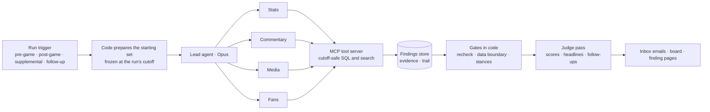

# NBL Storyline Desk, and a Daniel's Donuts Review Desk

**NBL Storyline Desk.** The Storyline Desk catches what you'd only notice by watching every minute with the record books open: the trends, records and turning points in each game and its coverage. It sends checked storylines to LK's internal teams before and after every game, so leadership, media and producers can agree on what to celebrate.

**Daniel's Donuts Review Desk.** The Review Desk reads every customer review each week and links it to the sales, staffing, stock and promotion data, a link that usually takes several teams in a room. It tells store, region and network leaders what's changing and why it might be, early, with the evidence attached, and gives them one place to discuss it.

Both make analysis that normally needs a specialist, or several teams, available to everyone at once, and give leadership one place to agree on what to do with it.

> This is a rapid build, about 1–1.5 days of full-time work, made to show Claude agent capability. The order of operations, timing, prompts and safety controls are informed guesses, not knowledge of LK's structure or priorities.

## Start here

1. **[The night in your inbox](https://fridai-dot-dev.github.io/nbl-storyline-desk/).** These are the pre-game and post-game emails as LK's internal teams would get them, from a real game: NBL27 Round 1, Melbourne United 95–97 Adelaide 36ers. The [board](https://fridai-dot-dev.github.io/nbl-storyline-desk/board.html) behind them is the desk's working view, with every story ranked alongside its evidence and stances.
2. **[Run it yourself, safely](docs/before-you-run.md).** You can run the offline checks for free, then re-run the desk on the same Round 1 game with your own Claude login or API key, and open the site it builds. The page covers what the agents can and can't touch, the spend caps, and how to check the code before you give it your account. The commands are [below](#run-it).
3. **[What's rough and what I assumed](docs/whats-rough.md).** It's honest about the gaps, with the [assumptions](docs/assumptions.md) behind them.

**Daniel's Donuts:** the [plan](docs/daniels-donuts/prd.md) and a [sample weekly email](https://fridai-dot-dev.github.io/nbl-storyline-desk/daniels-donuts/weekly.html) (illustrative data). The [code](src/reviewdesk/) builds the real Claude Agent SDK configuration and is checked offline. I'm happy to use this to walk you through how I build, in an interview or a working session.

## What the NBL desk found on Round 1

- **Cole Anthony scored 30 in 21:50,** the fewest minutes for a 30-point game in the box-score data since 2015-16. It's tagged sensitive because it touches his reported minutes limit.
- **Melbourne's bench outscored Adelaide's by 30, and Melbourne still lost.** This was a producer's follow-up. Since 2015-16, the weaker bench has won 18 of 74 games with a gap that size.
- **A fan's "10-point referee gift" claim, tested:** fourth-quarter free throws were 4 points to Melbourne and 5 to Adelaide.
- **Adelaide won from three:** 13 threes to 7, an 18-point edge, while Melbourne won the two-point battle 58–38.
- **Pre-game storylines were set as tests, then resolved.** Cotton's "Melbourne hold him to 21" was contradicted when he scored 29, and Goulding's "easier looks" when he went 1 of 6.

## How it works



- **Code sets the rails, and agents explore.** Each run is frozen at its cutoff, so a replayed game behaves as it would live. The agents get only the desk's own query tools: no web, no shell, no file writes.
- **Numbers are rechecked by code before release.** Records state where the data starts ("since at least 2015-16"). Email copy may only restate stored findings, and code checks that.
- **Everyone internal gets the same email at once.** Anyone can set a stance on any story: push it, use it if it comes up, or steer away. Sensitive stories (injury, officiating, fan quotes) aren't suggested for any comms until someone does. A steer-away blocks a story until it's withdrawn or overridden by the League GM or an LK director.

| Run | Time | Cost at API prices |
|---|---|---|
| Pre-game | 2.5 min | US$1.21 |
| Post-game | 3.0 min | US$2.16 |
| Supplemental (after the press conferences) | 3.3 min | US$1.77 |
| Producer follow-up | 3.3 min | US$1.54 |

That's about US$8 a game. [Cost](docs/cost.md) has the assumptions. [What each report could see](docs/data-provenance.md), and when, is in the data provenance.

## Docs

| Doc | For | When |
|---|---|---|
| [Proposal](docs/gm-proposal.md) · [Build vs buy](docs/build-vs-buy.md) · [Cost](docs/cost.md) | Leadership | Deciding on a pilot |
| [Before you run](docs/before-you-run.md) · [What's rough](docs/whats-rough.md) · [Assumptions](docs/assumptions.md) | Anyone running or judging it | Before running it |
| [PRD](docs/prd.md) · [Data provenance](docs/data-provenance.md) · [Verification](docs/verification.md) | Stakeholders | Checking what it does and where the data comes from |
| [Architecture](docs/architecture.md) · [Team pitch](docs/team-pitch.md) | Engineers | Reviewing the build |
| [Build log](docs/build-log.md) · [Review trail](docs/reviews/README.md) | Engineers | Seeing how it was built and reviewed |
| [Daniel's Donuts plan](docs/daniels-donuts/prd.md) | Leadership, engineers | The same approach for another LK business |

## Run it

Read [before you run](docs/before-you-run.md) first. What you get:

- **Offline checks** (free, about 15 minutes): the full test suite, with no model calls and no network.
- **A live re-run of the Round 1 game** (about 3 minutes and roughly US$2 at API prices for a post-game run): the agents work through the same frozen data, and the site command builds a fresh inbox, board and finding pages from your run in `site/`.

The desk can't yet be pointed at a different game. Collecting the commentary, live chat and articles for another game is still a manual step.

```bash
uv venv .venv && uv pip install --python .venv/bin/python -e ".[dev]"
.venv/bin/python -m pytest -q                       # offline checks: no model calls, no network
PYTHONPATH=src .venv/bin/python -m storydesk fetch && PYTHONPATH=src .venv/bin/python -m storydesk build-db
PYTHONPATH=src .venv/bin/python -m storydesk run post_game --game 36dbeb55-58ad-11f1-a69b-43a6b5595d3e --live
PYTHONPATH=src .venv/bin/python -m storydesk site   # builds site/ from the store
```

Live runs need a Claude login or an `ANTHROPIC_API_KEY`. Each run is capped at US$5, plus US$1 for the judge pass.

Built by Bart Lind, with Claude Code orchestrating and Codex building and reviewing.
