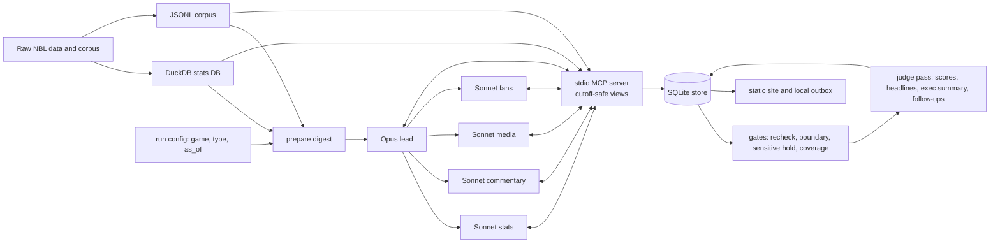

# Architecture

This is one research engine with five run modes. It reads a frozen view of the game and its corpus, then writes an inspectable ledger. The static site is built from that ledger. The approved [design](superpowers/specs/2026-10-28-nbl-storyline-desk-design.md) is the source for the product rules.



## Agent topology

The lead is `claude-opus-5-5`. Four specialists use `claude-sonnet-5-5`: stats, commentary, media and fans. The tree is depth 1. `CLAUDE_CODE_MAX_SUBAGENT_SPAWN_DEPTH=1` prevents specialists from starting agents. Each specialist receives explicit `mcpServers=["desk"]` and only its named `mcp__desk__*` tools. This avoids relying on inherited MCP access.

| Specialist | Explicit MCP tools |
| --- | --- |
| Stats | `stats_sql`, `get_game`, `write_finding`, `read_findings`, tracking-table create/update |
| Commentary | `search_transcripts`, `get_game`, `write_finding`, `read_findings` |
| Media | `search_media`, `search_transcripts`, `write_finding`, `read_findings` |
| Fans | `search_fans`, `write_finding`, `read_findings` |

The runner caps concurrency at 5, lead budget at US$5, and specialist turns at 8. It disables WebSearch, WebFetch, Bash, Write and Edit. Hooks log tool use and specialist lifecycle events. A wall-clock deadline is not delegated to the SDK: `runner.py` wraps the query in a timeout and calls `ClaudeSDKClient.interrupt()` when it expires. Limits are 1,800 seconds pre-game, 1,500 post-game, 900 supplemental, 600 follow-up, and 180 smoke. The post-game product deadline is still 30 minutes after the whistle.

## MCP, cutoff, and statistics

The shared stdio server gives both SDK and Claude Code routes the same nine tools: `stats_sql`, `get_game`, three corpus searches, finding read/write, and tracking-table create/update. It logs every call. Every context carries `as_of`.

`stats_sql` accepts one read-only `SELECT` or `WITH` statement. Its only base relations are `results`, `box_team`, `box_player`, and `pbp`. Mutating SQL, external scans, system tables, quoted identifiers and relations outside that allowlist are rejected. DuckDB exposes each relation as a temporary view of games whose recorded end time is at or before `as_of`. Transcript and fan searches filter timestamped records to the cutoff. Media uses dates, so same-day articles are excluded. This is the backtest guarantee, not a claim that the public web was searched live.

The statistics history is results from 1979 and team/player box scores from 2015-16. Record wording must therefore say “since at least 2015-16”. The demo play-by-play is the chosen game’s NBL match API payload. See [data provenance](data-provenance.md).

## Store and release rules

SQLite stores `runs`, `findings`, `evidence`, `directives`, `signoffs`, `requests`, `feedback`, tool calls and agent-made `track_*` tables. A run records cutoff, route, status, cost, duration, model usage, agent count, summary and executive summary. A finding records its parent, agent, source type, claim, one recheckable number and query, chart, audience, sensitivity, scores, headline and suggested follow-ups. Evidence records URL, timestamp or row reference, quote and stance.

Before release, code re-runs every checked number. The prompt contract permits one checked number per finding; other figures must be context from the same query row or separately checked. Attributed numbers stay in a sourced quote. A chart must use the same safe query, have a claim title and labels, highlight exactly one row matching the number, and use zero-baseline bars or a line for rates. Record claims need their data boundary.

Sensitive conflict, injury, officiating, legal and fan-quote findings are held. They are visible internally but require audience-specific sign-off for producers or partners. Required starting sources need a finding or “nothing found”; one top-up pass targets missing sources while time remains.

## Judge, runs, and site

After gates, a separate no-tool judge call scores audience fit and direction. Code computes novelty against pre-cutoff coverage. The judge also supplies compact headlines, an executive summary and up to three suggested follow-ups: rarity, on-pace, comparison and context. It does not replace the gates.

The run types are pre-game, post-game, supplemental and follow-up. Smoke is a short access check: each specialist must call an MCP tool. The site selects complete primary runs plus complete follow-ups whose anchors are published. It renders a pre-game briefing, post-game local email, supplemental addendum, producer board and finding pages. Buttons are static in the published site.

## Run and extend

```bash
PYTHONPATH=src .venv/bin/python -m storydesk fetch
PYTHONPATH=src .venv/bin/python -m storydesk build-db
PYTHONPATH=src .venv/bin/python -m storydesk run post_game --game <uuid> --live
PYTHONPATH=src .venv/bin/python -m storydesk rejudge --run-id <id> --live
PYTHONPATH=src .venv/bin/python -m storydesk site
```

`--live` is required for model work. To add a source, add its cutoff-safe collector and tool, register its source type and explicit specialist access, then add it to relevant digests, coverage checks and provenance. To add a run type, add its prompt and `RUN_TYPES` configuration, digest preparation, required-source coverage and site treatment.

## Known limits

This is a one-game public-data demo. It has no auth, scheduler, live feed, real email sending or live-web search. Captions can be wrong. Reddit was unavailable without a token. `pbp.rds` is deliberately not parsed because it exceeded this machine’s memory limit. Human backtest and user acceptance checks remain open. The [build log](build-log.md) records the observed failures and fixes.
